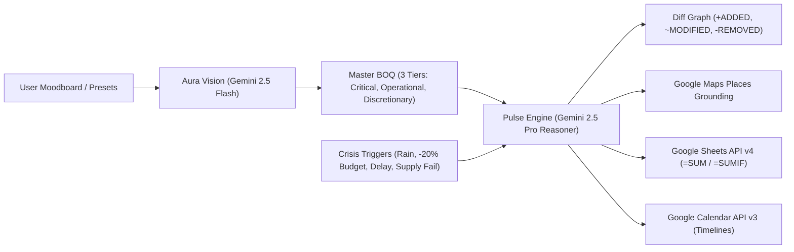

# AuraPulse AI

> **Autonomous Multimodal Event Planning & Reactive Contingency Engine**  
> *Target Challenge: Hack2Skill Google PromptWars | Platform: Google Antigravity | Version: 2.0.0-PROD*

[](https://hack2skill.com)
[](https://ai.google.dev)
[](https://nextjs.org)
[](https://fastapi.tiangolo.com)
[](https://cloud.google.com/run)
[](#automated-testing--verification)

---

## ⚡ 1. Judge Quick-Start (First 30 Seconds)

AuraPulse AI bridges the gap between aesthetic inspiration and real-world event resilience. To evaluate the live dashboard with zero friction:

1. **Launch the Dashboard**: Open [http://localhost:3000](http://localhost:3000) (or the live Cloud Run URL).
2. **Instant One-Click Presets**: Click any of the 3 pre-calibrated demo cards at the top of the interface to auto-hydrate the entire procurement matrix and run-of-show timeline:
   * 🌸 **Preset 1 (Wedding)**: *Boho Sunset Meadow Wedding* (Pune | 300 Pax | ₹15,00,000 | Pampas arch, 2,000 ft Edison festoons, farm-to-table banquet).
   * ⚡ **Preset 2 (Birthday)**: *Cyberpunk Neon 30th Birthday* (Mumbai | 60 Pax | ₹2,50,000 | Violet & electric cyan wash, wireless Astera tubes, DJ synthwave rig).
   * 🪔 **Preset 3 (Community)**: *Eco-Friendly Society Diwali Mela* (Pune | 800 Pax | ₹5,00,000 | Marigold yellow, zero-plastic food stalls, Puneri Dhol Tasha troupe).
3. **Trigger Real-Time Contingency**:
   * Click **`🌧️ Rain Storm Alert`**: Watch the engine automatically inject an emergency German Pagoda marquee into the BOQ, lock Tier-1 items, move outdoor schedule blocks, and trim Tier-3 discretionary florals to offset budget impact.
   * Click **`💸 Cut 20% Budget`**: Observe mathematical surgical trimming of Tier-3 lines while preserving Tier-1 guest safety, power, and food.
4. **Google Workspace Sync**:
   * Click **"Export Formula Sheets"** to view living Google Sheets with `=SUM(H2:H11)` & `=SUMIF(...)` formulas.
   * Click **"Sync Google Calendar"** to dispatch run-of-show timeline blocks with outdoor weather warning chips.

---

## 🏛️ 2. Architectural Topology & Data Flow

AuraPulse AI coordinates five architectural layers:

```
+-----------------------------------------------------------------------------------+
|                              1. CLIENT SURFACE                                    |
|   Next.js 15 (App Router) + Tailwind CSS + Lucide Icons + React Reactive Diff     |
|   Hosted on: Firebase App Hosting / Cloud CDN                                     |
+------------------------------------------+----------------------------------------+
                                           | HTTPS / Server-Sent Events (SSE)
                                           v
+-----------------------------------------------------------------------------------+
|                        2. API GATEWAY & SESSION MANAGER                           |
|   FastAPI (Python 3.12) / Cloud Run (Serverless, Autoscaling 0 -> 3)              |
|   • Session & Pydantic Strict Validation Engine                                   |
|   • Session State Management & Telemetry Stream                                   |
+---------------------+--------------------+----------------------------------------+
                      |                    |
        +-------------+                    +-------------+
        | Asynchronous SSE Event Bus                     | Structured Pipeline Calls
        v                                                v
+------------------------------------+   +------------------------------------------+
|  3. GEMINI REASONING CLUSTER       |   |  4. GOOGLE TOOL FABRIC & INTEGRATIONS    |
|  (Vertex AI / Google GenAI SDK)    |   |                                          |
|                                    |   |  • Google Maps Places API (Grounding)   |
|  A. Aura Deconstruct Agent        |   |    Nearby venue, caterer, decor search   |
|     (Gemini 2.5 Flash Multimodal)  |   |                                          |
|     Visual parsing -> BOQ mapping  |   |  • Google Sheets API v4                  |
|                                    |   |    Dynamic formulas, budgeting sheets    |
|  B. Pulse Dynamic Engine          |   |                                          |
|     (Gemini 2.5 Pro Reasoner)      |   |  • Google Calendar API v3                |
|     Multi-constraint graph solver  |   |    Run-of-show dispatch & rescheduling   |
|                                    |   |                                          |
|  C. Generative Studio              |   |  • Google Cloud Storage                  |
|     (Imagen 3 Endpoint)            |   |    Raw mood board assets & renders       |
|     Decor visual alternatives      |   |                                          |
+------------------------------------+   +------------------------------------------+
```



---

## 🌟 3. Key Google Innovations Matrix

| Google Service / Tech | Architectural Role | Value Add & Implementation Detail |
|---|---|---|
| **Google Gemini 2.5 Flash** | Multimodal Vision-to-BOQ Intake | Isolates structural trusses, botanical density, and lighting fixtures from raw pixels into structured, strict Pydantic models. |
| **Google Gemini 2.5 Pro** | Multi-Constraint Contingency Reasoner | Executes multi-turn reasoning when crises occur, locking Tier-1 lines and negotiating tradeoffs with deep operational rationale. |
| **Google Maps Places API** | Vendor Discovery & Grounding | Queries authentic local suppliers with live review scores (`>= 4.0`), addresses, and phone contacts for automated supplier hot-swapping. |
| **Google Sheets API v4** | Living Budget Exporter | Generates formula-driven workbooks with dynamic `=SUM(H2:H11)` totals and category `=SUMIF(...)` analytics instead of static flat tables. |
| **Google Calendar API v3** | Run-of-Show Dispatcher | Syncs chronological schedule blocks with outdoor microclimate tags and lead vendor assignments. |
| **Google Cloud Run** | Serverless Container Hosting | Containerized production deployment with autoscaling (0 to 3 instances), 1 vCPU, and 512MB RAM. |
| **Google Antigravity** | Autonomous Development Agent | Guided the monorepo architecture, enforced strict Pydantic rules, and executed automated headless verification passes. |

---

## 🛠️ 4. Reproducible Local Setup Instructions

### Prerequisites
* Python 3.12+ (or Python 3.14)
* Node.js v20+ & npm
* Google Cloud SDK (`gcloud`) optional for deployment

### Step 1: Clone & Environment Setup
```bash
git clone https://github.com/Hack2Skill-Google-PromptWars/AuraPulse-AI.git
cd "AuraPulse AI"

# Copy example environment configuration
cp .env.example .env  # Optional: inject GEMINI_API_KEY, GOOGLE_MAPS_API_KEY
```

### Step 2: Backend Setup (FastAPI Gateway)
```bash
# Create and activate Python virtual environment
python3 -m venv .venv
source .venv/bin/activate

# Install dependencies
pip install -r backend/requirements.txt

# Launch FastAPI development server (port 8000)
uvicorn app.main:app --app-dir backend --host 127.0.0.1 --port 8000 --reload
```
*Backend Swagger Docs*: [http://127.0.0.1:8000/docs](http://127.0.0.1:8000/docs)  
*Health Check*: [http://127.0.0.1:8000/api/health](http://127.0.0.1:8000/api/health)

### Step 3: Frontend Setup (Next.js 15 App Router)
In a separate terminal window:
```bash
cd frontend
npm install
npm run dev
```
Open **[http://localhost:3000](http://localhost:3000)** in your browser. Next.js proxies all `/api/*` requests directly to `http://127.0.0.1:8000`.

---

## 🧪 5. Automated Testing & Verification

AuraPulse AI includes automated test coverage for schemas, integrations, and API routes:

```bash
# Run pytest test suite
$ .venv/bin/pytest backend/tests/ -v

============================= test session starts ==============================
backend/tests/test_api_endpoints.py::test_health_endpoint PASSED         [  7%]
backend/tests/test_api_endpoints.py::test_deconstruct_endpoint PASSED    [ 14%]
backend/tests/test_api_endpoints.py::test_simulate_contingency_endpoint PASSED [ 21%]
backend/tests/test_api_endpoints.py::test_vendor_discovery_endpoint PASSED [ 28%]
backend/tests/test_api_endpoints.py::test_sheets_export_endpoint PASSED  [ 35%]
backend/tests/test_contingency.py::test_weather_risk_contingency PASSED  [ 42%]
backend/tests/test_contingency.py::test_budget_compression_contingency PASSED [ 50%]
backend/tests/test_contingency.py::test_timeline_slippage_contingency PASSED [ 57%]
backend/tests/test_integrations.py::test_google_maps_vendor_fetch PASSED [ 64%]
backend/tests/test_integrations.py::test_google_sheets_export_formulas PASSED [ 71%]
backend/tests/test_integrations.py::test_google_calendar_schedule_sync PASSED [ 78%]
backend/tests/test_schemas.py::test_boq_item_strict_validation PASSED    [ 85%]
backend/tests/test_schemas.py::test_master_event_plan_structure PASSED   [ 92%]
backend/tests/test_schemas.py::test_crisis_trigger_model PASSED          [100%]

======================== 14 passed in 0.22s =========================
```

Compile the frontend production bundle:
```bash
$ cd frontend && npm run build
# ✓ Compiled successfully in 881ms (zero TypeScript / Webpack errors)
```

---

## 🚢 6. Deployment Automation (Google Cloud Run)

To deploy the containerized backend to Google Cloud Run:
```bash
chmod +x deployment/deploy_cloud_run.sh
./deployment/deploy_cloud_run.sh
```
* Deploys container image via Google Cloud Build.
* Managed Cloud Run instance: 1 vCPU, 512MB RAM, min-instances 0, max-instances 3.
* Firebase App Hosting configured in [`deployment/firebase.json`](deployment/firebase.json) with Cloud CDN rewrites.

---

## 📁 7. Repository Structure

```
aurapulse-core/
├── .antigravity/
│   ├── rules.md                          # Antigravity agent operational guidelines
│   └── skills/
│       ├── test-gemini-schemas.yaml      # Schema validation skill
│       └── verify-google-apis.yaml       # Google API smoke testing skill
├── backend/
│   ├── app/
│   │   ├── main.py                       # FastAPI gateway, async routes & SSE streams
│   │   ├── config.py                     # App configuration & Google credentials
│   │   ├── schemas/                      # Pydantic schemas (strict=True)
│   │   │   ├── event_plan.py             # MasterEventPlan, BOQItem, ScheduleBlock
│   │   │   └── contingency.py            # CrisisTrigger, ContingencyDiff
│   │   ├── agents/
│   │   │   ├── aura_vision.py            # Gemini 2.5 Flash multimodal intake
│   │   │   ├── pulse_engine.py           # Gemini 2.5 Pro multi-constraint solver
│   │   │   └── generator_studio.py       # Imagen 3 alternative theme visualizer
│   │   └── integrations/
│   │       ├── google_maps.py            # Places API verified supplier discovery
│   │       ├── google_sheets.py          # Sheets API v4 dynamic formula workbook
│   │       └── google_calendar.py        # Calendar API v3 run-of-show scheduler
│   ├── tests/
│   │   ├── test_api_endpoints.py         # FastAPI TestClient HTTP smoke tests
│   │   ├── test_schemas.py               # Pydantic validation tests
│   │   ├── test_contingency.py           # Deterministic contingency solver tests
│   │   └── test_integrations.py          # Maps, Sheets formula, and Calendar tests
│   ├── requirements.txt
│   └── pytest.ini
├── frontend/
│   ├── src/
│   │   ├── app/                          # Next.js 15 App Router
│   │   │   ├── layout.tsx                # Obsidian & electric violet theme header
│   │   │   ├── page.tsx                  # Unified dashboard with fallback handling
│   │   │   └── globals.css               # Glassmorphism & custom utility styles
│   │   ├── components/
│   │   │   ├── MoodboardUploader.tsx     # One-click demo presets & image uploader
│   │   │   ├── BoqTable.tsx              # Itemized procurement matrix (3 tiers)
│   │   │   ├── ContingencyControls.tsx   # What-If crisis simulation toolbar
│   │   │   ├── DiffVisualizer.tsx        # Side-by-side cost delta & Gemini rationale
│   │   │   ├── ScheduleTimeline.tsx      # Chronological run-of-show with outdoor flags
│   │   │   ├── VendorFinder.tsx          # Google Maps verified vendor search
│   │   │   └── ExportActions.tsx         # Sheets Drive link & Calendar chips
│   │   └── lib/
│   │       └── api.ts                    # Strongly typed API client & offline fallback
│   ├── next.config.ts                    # Dynamic backend proxy configuration
│   ├── tailwind.config.ts
│   ├── tsconfig.json
│   └── package.json
├── docs/
│   └── submission/
│       ├── TECHNICAL_BLOG.md             # In-depth architectural article
│       ├── LINKEDIN_POST.md              # Build-in-public social announcement
│       └── SUBMISSION_METADATA.json      # Structured competition metadata
├── deployment/
│   ├── Dockerfile                        # Production Cloud Run container definition
│   ├── deploy_cloud_run.sh               # Automated deployment script
│   └── firebase.json                     # Firebase App Hosting & CDN configuration
└── README.md                             # Production documentation & judge guide
```

---

## 🏆 8. Hack2Skill Google PromptWars Submission Pack

* **Technical Blog**: [`docs/submission/TECHNICAL_BLOG.md`](docs/submission/TECHNICAL_BLOG.md)
* **LinkedIn Build-in-Public Post**: [`docs/submission/LINKEDIN_POST.md`](docs/submission/LINKEDIN_POST.md)
* **Submission Metadata**: [`docs/submission/SUBMISSION_METADATA.json`](docs/submission/SUBMISSION_METADATA.json)
* **Implementation Report**: [`AuraPulse_Implementation_Report.md`](file:///Users/nikhil/.gemini/antigravity/brain/b1dc3cc1-5af6-47d7-91db-bedc961dd696/AuraPulse_Implementation_Report.md)

---

*Crafted with Google Antigravity & Powered by Google Gemini 2.5.*
