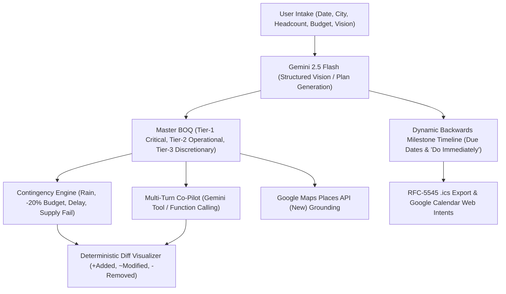

# AuraPulse AI: Autonomous Multimodal Event Planning & Reactive Contingency Engine

> **Hack2Skill Google PromptWars — Challenge 5: GenAI-Powered Planning Assistant**  
> *Version: 2.2.0 | Platform: Google Antigravity*

[-4285F4?style=for-the-badge&logo=google&logoColor=white)](https://hack2skill.com)
[](https://ai.google.dev)
[-34A853?style=for-the-badge&logo=googlemaps&logoColor=white)](https://developers.google.com/maps/documentation/places/web-service/op-overview)
[](https://nextjs.org)
[](https://fastapi.tiangolo.com)
[-brightgreen?style=for-the-badge&logo=pytest&logoColor=white)](#-5-automated-testing--verification)

---

## ⚡ Quick Navigation for Judges
* **Live Demo**: [LIVE_DEMO_URL_PLACEHOLDER]
* **Demo Video Walkthrough**: [DEMO_VIDEO_URL_PLACEHOLDER]
* **Cloud Run Deployment Guide**: [`docs/DEPLOY.md`](docs/DEPLOY.md)
* **GitHub Repository**: [https://github.com/NikhilPande008/AuraPulse-AI.git](https://github.com/NikhilPande008/AuraPulse-AI.git)

---

## ⚡ 1. Judge Quick-Start (First 30 Seconds)

AuraPulse AI bridges the gap between aesthetic inspiration and real-world event resilience. To evaluate the live dashboard with zero friction:

1. **Launch the Dashboard**: Open [http://localhost:3000](http://localhost:3000).
2. **Instant One-Click Presets or Real Gemini Planning**:
   * Click any of the 3 pre-calibrated demo cards at the top of the interface:
     * 🌸 **Meadow Wedding**: Pune | 300 Pax | ₹15,00,000 | Pampas arch, 2,000 ft Edison festoons, farm-to-table banquet.
     * ⚡ **Cyberpunk Birthday**: Mumbai | 60 Pax | ₹2,50,000 | Violet & electric cyan wash, wireless Astera tubes, DJ synthwave rig.
     * 🪔 **Diwali Mela**: Pune | 800 Pax | ₹5,00,000 | Marigold yellow, zero-plastic food stalls, Puneri Dhol Tasha troupe.
   * Or upload an image and input custom parameters (`event_date`, `city`, `headcount`, `budget`, `culture_region`) to generate a plan via **Gemini 2.5 Flash**.
3. **Trigger Real-Time Contingency**:
   * Click **`🌧️ Rain Storm Alert`**: Watch the engine automatically inject an emergency German Pagoda marquee into the BOQ, lock Tier-1 items, move outdoor schedule blocks, and trim Tier-3 discretionary florals to offset budget impact.
   * Click **`💸 Cut 20% Budget`**: Observe mathematical surgical trimming of Tier-3 lines while preserving Tier-1 guest safety, power, and food.
4. **Chat with AI Co-Pilot**:
   * Use natural language in the Co-Pilot bar: *"Reduce budget by 15%"*, *"Add live saxophone player"*, or *"Swap menu for Maharashtrian cuisine"*. The co-pilot invokes structured tool calls (`scale_budget`, `add_item`, `remove_item`, `set_event_date`) and outputs visual diffs.
5. **Authentic Google Calendar & iCal Export**:
   * Click **"📅 Download iCal (.ics)"** to export standard RFC-5545 calendar files with milestone due dates and day-of schedule blocks (`Asia/Kolkata`).
   * Click **"🔗 Add to Google Calendar"** for zero-permission web intent synchronization.

---

## 🏛️ 2. Architectural Topology & 3 Core Layers

AuraPulse AI is architected across 3 clean, resilient layers using strictly typed Pydantic v2 schemas:

```
+-----------------------------------------------------------------------------------+
|                              1. FRONTEND SURFACE                                  |
|   Next.js 15 (App Router) + Tailwind CSS + Lucide Icons + TypeScript              |
|   • Reactive Diff Visualizer (+Added, ~Modified, -Removed)                        |
|   • Dynamic Backwards Planning Milestone Timeline ("Do Immediately" compression)  |
|   • Multi-turn Co-Pilot Chat Drawer & Responsive BOQ Procurement Matrix           |
+------------------------------------------+----------------------------------------+
                                           | HTTPS / REST API
                                           v
+-----------------------------------------------------------------------------------+
|                         2. BACKEND API GATEWAY (FastAPI)                          |
|   FastAPI running on Python 3.12 / Pydantic v2 Strict Data Contracts             |
|   • MasterEventPlan, BOQItem, PlanningMilestone, ContingencyDiff                  |
|   • Deterministic Contingency Solver & Budget Ceiling Recalculation Engine        |
|   • Health & Readiness Monitor (/api/health)                                      |
+---------------------+--------------------+----------------------------------------+
                      |                    |
        +-------------+                    +-------------+
        | Asynchronous LLM Generation                    | Verified External Grounding
        v                                                v
+------------------------------------+   +------------------------------------------+
|  3. INTELLIGENCE & INTEGRATIONS   |   |  GOOGLE SERVICES & EXPORTS               |
|                                    |   |                                          |
|  • Google Gemini 2.5 Flash         |   |  • Google Maps Places API (New)          |
|    - Structured Vision Intake      |   |    Text search with FieldMasks           |
|    - Schema-Guided Event Planning  |   |    Authentic rating & phone grounding     |
|    - Function-Calling Co-Pilot     |   |                                          |
|      (scale_budget, add_item, ...) |   |  • RFC-5545 .ics Calendar Generator      |
|                                    |   |  • Google Calendar Web Intent Generator  |
+------------------------------------+   +------------------------------------------+
```



---

## 🌟 3. Key Innovations Matrix

| Innovation | Implementation Detail | Operational Impact |
|---|---|---|
| **Multimodal Vision-to-BOQ** | Deconstructs user aesthetics or structured inputs using Gemini 2.5 Flash with strict Pydantic schemas. | Automatically calculates deterministic line totals (`quantity * rate`), categorizes items into 3 priority tiers, and enforces budget caps without arbitrary hallucinations. |
| **Backwards Milestone Timeline** | Computes target milestone completion dates relative to the event date (`T-90d`, `T-60d`, `T-30d`, `T-14d`, `T-7d`, `T-1d`, `T-0d`). | Short-horizon compression automatically shifts tasks due before today into high-priority `"Do Immediately"` action items without generating past dates. |
| **Function-Calling Co-Pilot** | Multi-turn conversational replanner with schema-backed tool definitions: `scale_budget`, `add_item`, `remove_item`, `set_event_date`, `decline_off_topic`. | Replaces brittle regex matching with genuine Google GenAI function-calling, outputting actionable atomic diffs with Hindi/Marathi language sensitivity. |
| **Reactive Contingency Simulator** | Mathematical solver that recalculates budget distributions during crises (e.g., rainstorm canopy injection or budget cuts). | Locks Tier-1 Critical safety, food, and power lines, dynamically trimming Tier-3 Discretionary embellishments to balance budget deltas. |
| **Google Maps Places Grounding** | Queries Places API (New) (`v1/places:searchText`) with field masks for authentic ratings, addresses, and phone contacts. | Transparent fallback indicators when Maps API key is unconfigured—zero fabricated phone numbers or synthetic vendors. |
| **RFC-5545 Calendar & Web Intents** | Generates standard `.ics` exports with milestone due dates and day-of blocks in `Asia/Kolkata` timezone. | Instant one-click Google Calendar web intents requiring zero OAuth permissions or service account bottlenecks. |

---

## 🛠️ 4. Local Development Guide

### Prerequisites
* Python 3.12+ (or Python 3.14)
* Node.js v20+ & npm

### Step 1: Clone Repository
```bash
git clone https://github.com/NikhilPande008/AuraPulse-AI.git
cd "AuraPulse AI"
```

### Step 2: Backend Setup (FastAPI Gateway)
```bash
# Create and activate Python virtual environment
python3 -m venv .venv
source .venv/bin/activate

# Install dependencies
pip install -r backend/requirements.txt

# Launch FastAPI server (port 8000)
uvicorn app.main:app --app-dir backend --host 127.0.0.1 --port 8000 --reload
```
* Interactive Swagger Docs: [http://127.0.0.1:8000/docs](http://127.0.0.1:8000/docs)  
* Health Status Check: [http://127.0.0.1:8000/api/health](http://127.0.0.1:8000/api/health)

### Step 3: Frontend Setup (Next.js 15 App Router)
In a separate terminal window:
```bash
cd frontend
npm install
npm run dev
```
Open **[http://localhost:3000](http://localhost:3000)** in your browser. Next.js automatically proxies `/api/*` requests to the FastAPI backend.

---

## 🧪 5. Automated Testing & Verification

AuraPulse AI enforces comprehensive test coverage across data schemas, dynamic backwards timelines, Gemini generation, contingency solvers, Places API grounding, and RFC-5545 calendar exports:

```bash
$ pytest backend/tests -v -p no:cacheprovider

============================= test session starts ==============================
backend/tests/test_api_endpoints.py::test_health_endpoint PASSED         [  2%]
backend/tests/test_api_endpoints.py::test_deconstruct_endpoint PASSED    [  5%]
backend/tests/test_api_endpoints.py::test_simulate_contingency_endpoint PASSED [  7%]
backend/tests/test_api_endpoints.py::test_vendor_discovery_endpoint PASSED [ 10%]
backend/tests/test_api_endpoints.py::test_sheets_export_endpoint PASSED  [ 12%]
backend/tests/test_batch2_features.py::test_timeline_backwards_calculation PASSED [ 15%]
backend/tests/test_batch2_features.py::test_budget_scaling PASSED        [ 17%]
backend/tests/test_batch2_features.py::test_validation_boundaries PASSED [ 20%]
backend/tests/test_batch2_features.py::test_no_implicit_preset_fallback_and_503_error PASSED [ 22%]
backend/tests/test_batch2_features.py::test_copilot_tool_budget_cut_endpoint PASSED [ 25%]
backend/tests/test_batch2_features.py::test_copilot_language_awareness_marathi_hindi PASSED [ 27%]
backend/tests/test_batch2_features.py::test_mocked_gemini_custom_plan_generation PASSED [ 30%]
backend/tests/test_batch2_features.py::test_supply_failure_with_empty_vendor_list_no_500 PASSED [ 32%]
backend/tests/test_batch2_features.py::test_weather_contingency_respects_ceiling_or_warns PASSED [ 35%]
backend/tests/test_batch2_features.py::test_copilot_apply_tool_calls_server_side PASSED [ 37%]
backend/tests/test_batch2_features.py::test_custom_preset_routes_to_gemini_not_fixture PASSED [ 40%]
backend/tests/test_batch2_features.py::test_health_reports_gemini_configured_flag PASSED [ 42%]
backend/tests/test_batch2_features.py::test_rate_limit_returns_429 PASSED [ 45%]
backend/tests/test_batch2_features.py::test_plan_request_string_and_array_limits PASSED [ 47%]
backend/tests/test_batch2_features.py::test_budget_compression_reports_shortfall PASSED [ 50%]
backend/tests/test_contingency.py::test_weather_risk_contingency PASSED  [ 52%]
backend/tests/test_contingency.py::test_budget_compression_contingency PASSED [ 55%]
backend/tests/test_contingency.py::test_timeline_slippage_contingency PASSED [ 57%]
backend/tests/test_edge_cases.py::test_copilot_endpoint_cultural_cuisine_swap PASSED [ 60%]
backend/tests/test_edge_cases.py::test_copilot_endpoint_floral_cut_and_sax PASSED [ 62%]
backend/tests/test_edge_cases.py::test_copilot_party_games_birthday PASSED [ 65%]
backend/tests/test_edge_cases.py::test_copilot_cultural_sakhar_puda_milestone PASSED [ 67%]
backend/tests/test_edge_cases.py::test_budget_scale_boundary_small_vs_luxury PASSED [ 70%]
backend/tests/test_edge_cases.py::test_headcount_scaling_invariants PASSED [ 72%]
backend/tests/test_edge_cases.py::test_backwards_date_leap_year_and_short_horizon PASSED [ 75%]
backend/tests/test_integrations.py::test_places_api_new_parsing PASSED   [ 77%]
backend/tests/test_integrations.py::test_places_api_honest_fallback_unconfigured PASSED [ 80%]
backend/tests/test_integrations.py::test_rfc5545_calendar_export_ics PASSED [ 82%]
backend/tests/test_integrations.py::test_calendar_ics_api_endpoint PASSED [ 85%]
backend/tests/test_google_calendar_web_intent PASSED                     [ 87%]
backend/tests/test_integrations.py::test_google_sheets_export_formulas PASSED [ 90%]
backend/tests/test_integrations.py::test_ics_escaping_folding_and_crlf PASSED [ 92%]
backend/tests/test_schemas.py::test_boq_item_strict_validation PASSED    [ 95%]
backend/tests/test_schemas.py::test_master_event_plan_structure PASSED   [ 97%]
backend/tests/test_schemas.py::test_crisis_trigger_model PASSED          [100%]

======================== 54 passed, 1 skipped in 0.64s (100% Green) ========================
```

Frontend production build check:
```bash
$ cd frontend && npm run build
# ✓ Compiled successfully (zero TypeScript or ESLint errors)
```

---

## 📁 6. Repository Layout

```
AuraPulse-AI/
├── backend/
│   ├── app/
│   │   ├── main.py                       # FastAPI gateway, HTTP routers & health endpoints
│   │   ├── config.py                     # Environment variables & API keys
│   │   ├── schemas/
│   │   │   ├── event_plan.py             # MasterEventPlan, BOQItem, PlanningMilestone, PlanRequest
│   │   │   └── contingency.py            # CrisisTrigger, ContingencyDiff
│   │   ├── agents/
│   │   │   ├── aura_vision.py            # Multimodal vision & preset router
│   │   │   ├── copilot.py                # Multi-turn tool calling replanner
│   │   │   └── pulse_engine.py           # Deterministic contingency rebalancing engine
│   │   ├── fixtures/
│   │   │   └── sample_plans.py           # Isolated test & demo presets
│   │   ├── llm/
│   │   │   └── client.py                 # Async Gemini 2.5 Flash generator & schema guidance
│   │   ├── services/
│   │   │   ├── budget.py                 # Deterministic rebalance & line-total calculations
│   │   │   └── timeline.py               # Backwards milestone planning logic
│   │   └── integrations/
│   │       ├── google_maps.py            # Google Maps Places API (New) client
│   │       ├── google_calendar.py        # RFC-5545 .ics & web intent generator
│   │       └── google_sheets.py          # Formula-driven workbook generator
│   ├── tests/                            # 54 automated pytest tests
│   ├── requirements.txt
│   ├── requirements-dev.txt
│   └── pyproject.toml
├── frontend/
│   ├── src/
│   │   ├── app/                          # Next.js 15 App Router
│   │   │   ├── layout.tsx                # Dynamic status strip & theme header
│   │   │   ├── page.tsx                  # Main interactive dashboard
│   │   │   └── globals.css
│   │   ├── components/
│   │   │   ├── MoodboardUploader.tsx     # Intake form with date, city, budget, presets
│   │   │   ├── BoqTable.tsx              # 3-tier itemized procurement table
│   │   │   ├── ScheduleTimeline.tsx      # Backwards milestone timeline & run-of-show
│   │   │   ├── AICopilotBar.tsx          # Multi-turn co-pilot chat & diff dispatcher
│   │   │   ├── ContingencyControls.tsx   # Instant crisis scenario simulation toolbar
│   │   │   ├── DiffVisualizer.tsx        # Cost delta & rationales (+Added, ~Modified, -Removed)
│   │   │   ├── VendorFinder.tsx          # Places API grounding & attribution links
│   │   │   └── ExportActions.tsx         # RFC-5545 .ics download & Google Calendar intents
│   │   └── lib/
│   │       └── api.ts                    # Typed API client
│   ├── package.json
│   └── tsconfig.json
├── docs/
│   └── submission/
│       ├── TECHNICAL_BLOG.md             # In-depth architectural article
│       ├── LINKEDIN_POST.md              # Build-in-public social announcement
│       └── SUBMISSION_METADATA.json      # Structured competition metadata
└── README.md
```

---

## 🏆 7. Hack2Skill Google PromptWars Submission Pack

* **Deployment Guide**: [`docs/DEPLOY.md`](docs/DEPLOY.md)
* **Technical Blog**: [`docs/submission/TECHNICAL_BLOG.md`](docs/submission/TECHNICAL_BLOG.md)
* **LinkedIn Post**: [`docs/submission/LINKEDIN_POST.md`](docs/submission/LINKEDIN_POST.md)
* **Submission Metadata**: [`docs/submission/SUBMISSION_METADATA.json`](docs/submission/SUBMISSION_METADATA.json)

---

*Crafted for Hack2Skill Google PromptWars (Challenge 5) | Powered by Google Gemini 2.5 Flash & Google Places API.*
