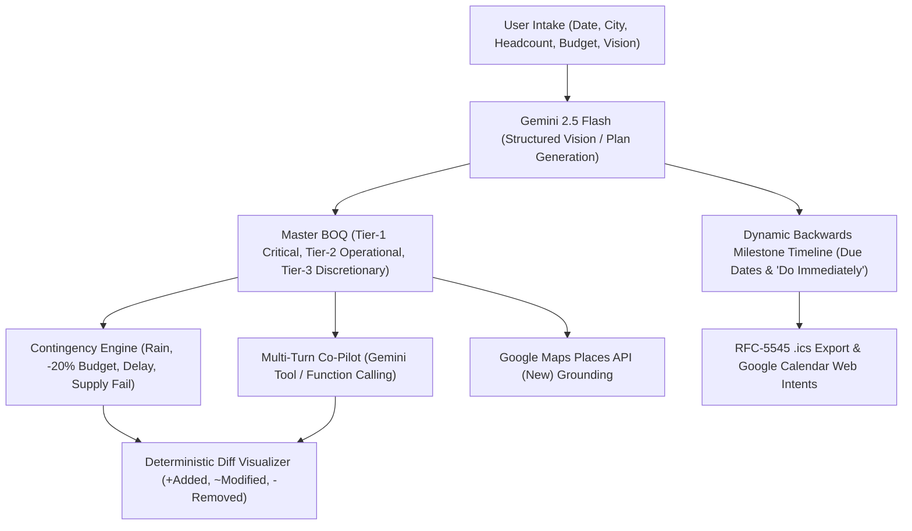

# AuraPulse AI: Autonomous Multimodal Event Planning & Reactive Contingency Engine

> **Hack2Skill Google PromptWars — Challenge 5: GenAI-Powered Planning Assistant**  
> *Version: 2.2.0 | Platform: Google Antigravity*

[-4285F4?style=for-the-badge&logo=google&logoColor=white)](https://hack2skill.com)
[](https://ai.google.dev)
[-34A853?style=for-the-badge&logo=googlemaps&logoColor=white)](https://developers.google.com/maps/documentation/places/web-service/op-overview)
[](https://nextjs.org)
[](https://fastapi.tiangolo.com)
[-brightgreen?style=for-the-badge&logo=pytest&logoColor=white)](#-6-automated-testing--verification)
[](#-6-automated-testing--verification)
[](#-6-automated-testing--verification)

---

> [!TIP]
> **Live Production Deployment & Video Walkthrough**:
> - 🌐 **Live Web Application**: [https://aurapulse-web-gwe45twb3q-uc.a.run.app](https://aurapulse-web-gwe45twb3q-uc.a.run.app)
> - 🎬 **YouTube Demo Video Walkthrough**: [https://youtu.be/DQr9v43w94c](https://youtu.be/DQr9v43w94c)
> - ⚡ **Backend API**: [https://aurapulse-backend-gwe45twb3q-uc.a.run.app](https://aurapulse-backend-gwe45twb3q-uc.a.run.app)
> - 🩺 **API Health Check**: [https://aurapulse-backend-gwe45twb3q-uc.a.run.app/api/health](https://aurapulse-backend-gwe45twb3q-uc.a.run.app/api/health)

## ⚡ Quick Navigation for Judges
* **Live Web App**: [https://aurapulse-web-gwe45twb3q-uc.a.run.app](https://aurapulse-web-gwe45twb3q-uc.a.run.app)
* **Demo Video Walkthrough (YouTube)**: [https://youtu.be/DQr9v43w94c](https://youtu.be/DQr9v43w94c)
* **Cloud Run Deployment Guide**: [`docs/DEPLOY.md`](docs/DEPLOY.md)
* **GitHub Repository**: [https://github.com/NikhilPande008/AuraPulse-AI.git](https://github.com/NikhilPande008/AuraPulse-AI.git)

---

## Chosen Vertical: Celebration & Event Planner (Challenge 5)

AuraPulse AI is purpose-built for **Celebration & Event Planner** under Hack2Skill Google PromptWars Challenge 5. Indian event management involves high operational complexity: multi-vendor coordination, tight multi-tier budget constraints, cultural ritual milestones (Maharashtrian, Marwari, Punjabi), severe weather vulnerability, and dynamic run-of-show synchronization across hosts, venue managers, and vendors. AuraPulse AI provides an autonomous multimodal planner and reactive contingency copilot that transforms visual moodboards into itemized procurement matrices, backwards roadmaps, and deterministic contingency plans.

## Approach and Logic

AuraPulse AI combines **generative aesthetic extraction** with **deterministic operational constraint solving**:

1. **Aesthetic Deconstruction**: Deconstructs user-uploaded Pinterest/Instagram moodboards or pre-calibrated presets using Google Gemini 2.5 Flash into typed, itemized Bill of Quantities (`BOQItem`) with unit pricing, quantity, and priority tiers (`Critical`, `Operational`, `Discretionary`).
2. **Backwards Temporal Scheduling**: Working backwards from a user-specified event date, milestones are pegged to canonical planning horizons (`T-6 Months`, `T-3 Months`, `T-1 Month`, `T-2 Weeks`, `T-1 Week`, `Day-Of`). Short-horizon compression shifts past milestones into `"Do Immediately"` action items without fabricating past dates.
3. **Deterministic Constraint-Preserving Contingency**: During disruptions (rain alerts, 20% budget cuts, timeline slippage, vendor failures), the Pulse Engine preserves Tier-1 Critical safety, food, and power lines, dynamically trimming Tier-3 Discretionary embellishments to balance budget deltas while enforcing strict budget ceilings.
4. **Conversational Tool Dispatch**: Natural language user prompts are dispatched via Gemini function calling into typed tool executions (`scale_budget`, `add_item`, `remove_item`, `set_event_date`, `change_headcount`), emitting actionable atomic diffs (+Added, ~Modified, -Removed) with Hindi and Marathi language sensitivity.

## How the Solution Works

1. **Multimodal Vision Intake**: The user submits an event date, city, headcount, and budget ceiling, uploading a decor image or selecting a demo preset. Gemini 2.5 Flash extracts color palettes, decor elements, and cultural context, generating a typed `MasterEventPlan`.
2. **Backwards Roadmap & Run-of-Show Generation**: The backend timeline service computes concrete calendar deadlines for critical milestones and hourly day-of schedule blocks. Run-of-show blocks track indoor vs outdoor zones for weather monitoring.
3. **Reactive Contingency Simulation (Pulse Engine)**: The user triggers crisis scenarios (`Rain Storm Alert`, `Cut 20% Budget`, `2hr Timeline Delay`, `Caterer Cancelled`). The engine adapts the plan in milliseconds: injecting emergency structures (e.g. German Pagoda Marquee), adjusting schedules, and rebalancing costs against the budget ceiling.
4. **Localized Vendor Grounding**: Google Maps Places API (New) performs real-time searches for verified caterers, decorators, and technicians with field masks for authentic ratings, addresses, and contacts.
5. **Universal Workspace Export**: Planners export interactive formula-driven spreadsheets via Google Sheets API v4 (`=SUM(...)`, `=SUMIF(...)`), download standard RFC-5545 `.ics` calendars, or synchronize run-of-show directly to Google Calendar via zero-permission web intents.

## Assumptions Made

1. **Currency & Metropolitan Localization**: Costs are denominated in Indian Rupees (INR) with standard pricing conventions for Tier-1 and Tier-2 Indian metropolitan markets (Mumbai, Pune, Delhi, Bangalore).
2. **Tier-1 Critical Immutability**: Core infrastructure, guest safety assets (weatherproofing marquee, electrical distribution, emergency shelter), sanitary food catering, and primary sound systems are designated as Tier-1 Critical and cannot be cut during budget compression without explicit shortfall warnings.
3. **Zero-Hallucination Vendor Integrity**: When Google Maps Places API keys are unconfigured, AuraPulse AI never fabricates synthetic phone numbers or fictitious vendors; it renders honest unconfigured badges and fallback procurement checklists.
4. **Zero-OAuth Friction**: Calendar export prioritizes RFC-5545 `.ics` downloads and Google Calendar web intents to ensure immediate zero-permission interoperability for clients and venue coordinators without requiring Google Cloud Workspace administrator approvals.

---

## ⚡ 1. Judge Quick-Start & Local Run

AuraPulse AI bridges the gap between aesthetic inspiration and real-world event resilience.

### Step 1: Clone & Install
```bash
git clone https://github.com/NikhilPande008/AuraPulse-AI.git
cd AuraPulse-AI

# Backend virtualenv & dependencies
python3 -m venv .venv && source .venv/bin/activate
pip install -r backend/requirements.txt

# Frontend dependencies
cd frontend && npm ci && cd ..
```

### Step 2: Run Locally
In Terminal 1 (Backend Gateway on port 8000):
```bash
source .venv/bin/activate
uvicorn app.main:app --app-dir backend --host 127.0.0.1 --port 8000 --reload
```

In Terminal 2 (Frontend App on port 3000):
```bash
cd frontend
npm run dev
```

Open **[http://localhost:3000](http://localhost:3000)** in your browser. Next.js automatically proxies `/api/*` requests to the FastAPI backend.

### Step 3: Evaluate Core Workflows (First 30 Seconds)
1. **Instant One-Click Presets or Real Gemini Planning**:
   * Click any of the 3 pre-calibrated demo cards at the top of the interface:
     * 🌸 **Meadow Wedding**: Pune | 300 Pax | ₹15,00,000 | Pampas arch, 2,000 ft Edison festoons, farm-to-table banquet.
     * ⚡ **Cyberpunk Birthday**: Mumbai | 60 Pax | ₹2,50,000 | Violet & electric cyan wash, wireless Astera tubes, DJ synthwave rig.
     * 🪔 **Diwali Mela**: Pune | 800 Pax | ₹5,00,000 | Marigold yellow, zero-plastic food stalls, Puneri Dhol Tasha troupe.
   * Or upload an image and input custom parameters (`event_date`, `city`, `headcount`, `budget`, `culture_region`) to generate a plan via **Gemini 2.5 Flash**.
2. **Trigger Real-Time Contingency**:
   * Click **`🌧️ Rain Storm Alert`**: Watch the engine automatically inject an emergency German Pagoda marquee into the BOQ, lock Tier-1 items, move outdoor schedule blocks, and trim Tier-3 discretionary florals to offset budget impact.
   * Click **`💸 Cut 20% Budget`**: Observe mathematical surgical trimming of Tier-3 lines while preserving Tier-1 guest safety, power, and food.
3. **Chat with AI Co-Pilot**:
   * Use natural language in the Co-Pilot bar: *"Reduce budget by 15%"*, *"Add live saxophone player"*, or *"Swap menu for Maharashtrian cuisine"*. The co-pilot invokes structured tool calls (`scale_budget`, `add_item`, `remove_item`, `set_event_date`) and outputs visual diffs.
4. **Authentic Google Calendar & iCal Export**:
   * Click **"📅 Download iCal (.ics)"** to export standard RFC-5545 calendar files with milestone due dates and day-of schedule blocks (`Asia/Kolkata`).
   * Click **"🔗 Add to Google Calendar"** for zero-permission web intent synchronization.

---

## 🏛️ 2. Architectural Topology & 3 Core Layers

AuraPulse AI is architected across 3 clean, resilient layers using strictly typed Pydantic v2 schemas:

```
+-----------------------------------------------------------------------------------+
|                              1. FRONTEND SURFACE                                  |
|   Next.js 15 (App Router) + Tailwind CSS + Lucide Icons + TypeScript              |
|   • Reactive Diff Visualizer (+Added, ~Modified, -Removed)                        |
|   • Dynamic Backwards Planning Milestone Timeline ("Do Immediately" compression)  |
|   • Multi-turn Co-Pilot Chat Drawer & Responsive BOQ Procurement Matrix           |
+------------------------------------------+----------------------------------------+
                                           | HTTPS / REST API
                                           v
+-----------------------------------------------------------------------------------+
|                         2. BACKEND API GATEWAY (FastAPI)                          |
|   FastAPI running on Python 3.12 / Pydantic v2 Strict Data Contracts             |
|   • MasterEventPlan, BOQItem, PlanningMilestone, ContingencyDiff                  |
|   • Deterministic Contingency Solver & Budget Ceiling Recalculation Engine        |
|   • Health & Readiness Monitor (/api/health)                                      |
+---------------------+--------------------+----------------------------------------+
                      |                    |
        +-------------+                    +-------------+
        | Asynchronous LLM Generation                    | Verified External Grounding
        v                                                v
+------------------------------------+   +------------------------------------------+
|  3. INTELLIGENCE & INTEGRATIONS   |   |  GOOGLE SERVICES & EXPORTS               |
|                                    |   |                                          |
|  • Google Gemini 2.5 Flash         |   |  • Google Maps Places API (New)          |
|    - Structured Vision Intake      |   |    Text search with FieldMasks           |
|    - Schema-Guided Event Planning  |   |    Authentic rating & phone grounding     |
|    - Function-Calling Co-Pilot     |   |                                          |
|      (scale_budget, add_item, ...) |   |  • RFC-5545 .ics Calendar Generator      |
|                                    |   |  • Google Calendar Web Intent Generator  |
+------------------------------------+   +------------------------------------------+
```



---

## 🌟 3. Key Innovations Matrix

| Innovation | Implementation Detail | Operational Impact |
|---|---|---|
| **Multimodal Vision-to-BOQ** | Deconstructs user aesthetics or structured inputs using Gemini 2.5 Flash with strict Pydantic schemas. | Automatically calculates deterministic line totals (`quantity * rate`), categorizes items into 3 priority tiers, and enforces budget caps without arbitrary hallucinations. |
| **Backwards Milestone Timeline** | Computes target milestone completion dates relative to the event date (`T-90d`, `T-60d`, `T-30d`, `T-14d`, `T-7d`, `T-1d`, `T-0d`). | Short-horizon compression automatically shifts tasks due before today into high-priority `"Do Immediately"` action items without generating past dates. |
| **Function-Calling Co-Pilot** | Multi-turn conversational replanner with schema-backed tool definitions: `scale_budget`, `add_item`, `remove_item`, `set_event_date`, `decline_off_topic`. | Replaces brittle regex matching with genuine Google GenAI function-calling, outputting actionable atomic diffs with Hindi/Marathi language sensitivity. |
| **Reactive Contingency Simulator** | Mathematical solver that recalculates budget distributions during crises (e.g., rainstorm canopy injection or budget cuts). | Locks Tier-1 Critical safety, food, and power lines, dynamically trimming Tier-3 Discretionary embellishments to balance budget deltas. |
| **Google Maps Places Grounding** | Queries Places API (New) (`v1/places:searchText`) with field masks for authentic ratings, addresses, and phone contacts. | Transparent fallback indicators when Maps API key is unconfigured—zero fabricated phone numbers or synthetic vendors. |
| **RFC-5545 Calendar & Web Intents** | Generates standard `.ics` exports with milestone due dates and day-of blocks in `Asia/Kolkata` timezone. | Instant one-click Google Calendar web intents requiring zero OAuth permissions or service account bottlenecks. |

---

## ⚠️ 4. Known Limitations & Design Boundaries

1. **Budget Compression Limits (>40%)**: When budget reductions exceed 40%, the contingency engine reports an explicit shortfall warning because Tier-1 Critical deliverables (food safety, emergency weather shelter, primary electrical generators) are locked and protected from arbitrary cuts by design.
2. **Google Places Grounding Key Requirement**: Google Maps Places API requires an active `GOOGLE_MAPS_API_KEY` with Places API (New) enabled. When unconfigured, the UI honestly renders an empty vendor catalog with an inactive badge (`Places Grounding: Inactive`), adhering strictly to zero fabricated vendors.
3. **Google Sheets OAuth / Service Account**: Google Sheets workbook export requires a service account JSON with Google Sheets API access. In the absence of credentials, the endpoint returns an explicit `503 SHEETS_NOT_CONFIGURED` error rather than silent failure.
4. **Deterministic Offline Fallback**: When `GEMINI_API_KEY` is unconfigured, the system enters a deterministic rule-based offline fallback mode that serves pre-validated event architectures, backwards planning schedules, and mathematical diff computations without crashing.

---

## 🛠️ 5. Local Development Guide

### Prerequisites
* Python 3.12+ (or Python 3.14)
* Node.js v20+ & npm

### Environment Configuration

A template `.env.example` is provided in the repository root. Copy it to `.env`:

```bash
cp .env.example .env
```

| Variable | Type | Default | Description |
|---|---|---|---|
| `PROJECT_NAME` | String | `"AuraPulse AI"` | Application service name. |
| `VERSION` | String | `"2.2.0"` | Semantic service version. |
| `API_V1_STR` | String | `"/api/v1"` | API v1 route prefix. |
| `GEMINI_API_KEY` | Secret | `""` | Google Gemini API key for multimodal intake, Flash replanning, and Imagen 3. |
| `GEMINI_FLASH_MODEL` | String | `"gemini-2.5-flash"` | Gemini model identifier used for event plan generation. |
| `GOOGLE_MAPS_API_KEY` | Secret | `""` | Google Maps API key for Places API (New) verified vendor search. |
| `GOOGLE_APPLICATION_CREDENTIALS` | Path | `""` | Path to Google Service Account JSON key for live Google Sheets API v4 export. |
| `RATE_LIMIT_PER_MINUTE` | Integer | `10` | Sliding window request rate limit per minute per client IP. |
| `RATE_LIMIT_PER_DAY` | Integer | `100` | Sliding window request rate limit per day per client IP. |
| `TRUSTED_PROXY_HOPS` | Integer | `1` | Upstream proxy hops to trust when resolving client IP from `X-Forwarded-For`. |
| `PORT` | Integer | `8000` | Port number to bind HTTP server. |
| `HOST` | String | `"0.0.0.0"` | Host interface address to bind HTTP server. |
| `ALLOWED_ORIGIN` | String | `""` | Additional comma-separated origins for CORS header whitelist. |

### Step 1: Clone Repository
```bash
git clone https://github.com/NikhilPande008/AuraPulse-AI.git
cd AuraPulse-AI
```

### Step 2: Backend Setup (FastAPI Gateway)
```bash
# Create and activate Python virtual environment
python3 -m venv .venv
source .venv/bin/activate

# Install dependencies
pip install -r backend/requirements.txt

# Launch FastAPI server (port 8000)
uvicorn app.main:app --app-dir backend --host 127.0.0.1 --port 8000 --reload
```
* Interactive Swagger Docs: [http://127.0.0.1:8000/docs](http://127.0.0.1:8000/docs)  
* Health Status Check: [http://127.0.0.1:8000/api/health](http://127.0.0.1:8000/api/health)

### Step 3: Frontend Setup (Next.js 15 App Router)
In a separate terminal window:
```bash
cd frontend
npm install
npm run dev
```
Open **[http://localhost:3000](http://localhost:3000)** in your browser. Next.js automatically proxies `/api/*` requests to the FastAPI backend.

---

## 🧪 6. Automated Testing & Verification

AuraPulse AI enforces comprehensive test coverage across backend business logic, dynamic backwards timelines, Gemini generation, contingency solvers, Places API grounding, Vitest frontend unit tests, and Playwright end-to-end accessibility scans:

### Backend Pytest Suite (72/72 Passing)
```bash
$ pytest backend/tests -v -m "not live"
============================= test session starts ==============================
backend/tests/test_api_endpoints.py::test_health_endpoint PASSED         [  1%]
backend/tests/test_api_endpoints.py::test_deconstruct_endpoint PASSED    [  2%]
backend/tests/test_api_endpoints.py::test_simulate_contingency_endpoint PASSED [  4%]
backend/tests/test_api_endpoints.py::test_vendor_discovery_endpoint PASSED [  5%]
backend/tests/test_api_endpoints.py::test_sheets_export_endpoint PASSED  [  7%]
backend/tests/test_batch2_features.py::test_timeline_backwards_calculation PASSED [  8%]
backend/tests/test_batch2_features.py::test_budget_scaling PASSED        [ 10%]
backend/tests/test_batch2_features.py::test_validation_boundaries PASSED [ 11%]
backend/tests/test_batch2_features.py::test_no_implicit_preset_fallback_and_503_error PASSED [ 13%]
backend/tests/test_batch2_features.py::test_copilot_tool_budget_cut_endpoint PASSED [ 14%]
backend/tests/test_batch2_features.py::test_copilot_language_awareness_marathi_hindi PASSED [ 16%]
backend/tests/test_batch2_features.py::test_mocked_gemini_custom_plan_generation PASSED [ 17%]
backend/tests/test_batch2_features.py::test_supply_failure_with_empty_vendor_list_no_500 PASSED [ 19%]
backend/tests/test_batch2_features.py::test_weather_contingency_respects_ceiling_or_warns PASSED [ 20%]
backend/tests/test_batch2_features.py::test_copilot_apply_tool_calls_server_side PASSED [ 22%]
backend/tests/test_batch2_features.py::test_custom_preset_routes_to_gemini_not_fixture PASSED [ 23%]
backend/tests/test_batch2_features.py::test_health_reports_gemini_configured_flag PASSED [ 25%]
backend/tests/test_batch2_features.py::test_rate_limit_returns_429 PASSED [ 26%]
backend/tests/test_batch2_features.py::test_plan_request_string_and_array_limits PASSED [ 32%]
backend/tests/test_batch2_features.py::test_budget_compression_reports_shortfall PASSED [ 33%]
backend/tests/test_contingency.py::test_weather_risk_contingency PASSED  [ 35%]
backend/tests/test_contingency.py::test_budget_compression_contingency PASSED [ 37%]
backend/tests/test_contingency.py::test_timeline_slippage_contingency PASSED [ 38%]
backend/tests/test_edge_cases.py::test_copilot_endpoint_cultural_cuisine_swap PASSED [ 40%]
backend/tests/test_edge_cases.py::test_copilot_endpoint_floral_cut_and_sax PASSED [ 42%]
backend/tests/test_edge_cases.py::test_copilot_party_games_birthday PASSED [ 44%]
backend/tests/test_edge_cases.py::test_copilot_cultural_sakhar_puda_milestone PASSED [ 45%]
backend/tests/test_edge_cases.py::test_budget_scale_boundary_small_vs_luxury PASSED [ 47%]
backend/tests/test_edge_cases.py::test_headcount_scaling_invariants PASSED [ 49%]
backend/tests/test_edge_cases.py::test_backwards_date_leap_year_and_short_horizon PASSED [ 50%]
backend/tests/test_headcount.py::test_add_50_guests_increases_from_300_to_350 PASSED [ 52%]
backend/tests/test_headcount.py::test_set_guests_to_250_is_absolute PASSED [ 54%]
backend/tests/test_headcount.py::test_change_headcount_out_of_range_warns PASSED [ 55%]
backend/tests/test_headcount.py::test_copilot_dispatches_change_headcount PASSED [ 57%]
backend/tests/test_headcount.py::test_hindi_and_marathi_headcount_updates PASSED [ 59%]
backend/tests/test_integrations.py::test_places_api_new_parsing PASSED   [ 61%]
backend/tests/test_integrations.py::test_places_api_honest_fallback_unconfigured PASSED [ 62%]
backend/tests/test_integrations.py::test_rfc5545_calendar_export_ics PASSED [ 64%]
backend/tests/test_integrations.py::test_calendar_ics_api_endpoint PASSED [ 66%]
backend/tests/test_integrations.py::test_google_calendar_web_intent PASSED [ 67%]
backend/tests/test_integrations.py::test_google_sheets_export_formulas PASSED [ 69%]
backend/tests/test_integrations.py::test_ics_escaping_folding_and_crlf PASSED [ 71%]
backend/tests/test_no_hardcoded_dates.py::test_no_hardcoded_dates_in_production_code PASSED [ 72%]
backend/tests/test_no_hardcoded_dates.py::test_preset_without_date_gets_future_event_date_and_milestones PASSED [ 74%]
backend/tests/test_offline_copilot_batch4.py::test_offline_declines_injection_and_off_topic PASSED [ 76%]
backend/tests/test_offline_copilot_batch4.py::test_offline_parses_absolute_date_move PASSED [ 77%]
backend/tests/test_offline_copilot_batch4.py::test_offline_parses_relative_two_weeks_earlier PASSED [ 79%]
backend/tests/test_offline_copilot_batch4.py::test_offline_rejects_past_date_move PASSED [ 81%]
backend/tests/test_offline_copilot_batch4.py::test_offline_declines_college_essay PASSED [ 83%]
backend/tests/test_offline_copilot_batch4.py::test_offline_declines_hindi_homework PASSED [ 84%]
backend/tests/test_offline_copilot_batch4.py::test_hindi_add_50_guests_300_to_350 PASSED [ 86%]
backend/tests/test_offline_copilot_batch4.py::test_marathi_add_50_guests_300_to_350 PASSED [ 88%]
backend/tests/test_offline_copilot_batch4.py::test_hindi_remove_50_guests_300_to_250 PASSED [ 89%]
backend/tests/test_schemas.py::test_boq_item_strict_validation PASSED    [ 91%]
backend/tests/test_schemas.py::test_master_event_plan_structure PASSED   [ 93%]
backend/tests/test_schemas.py::test_crisis_trigger_model PASSED          [ 94%]
backend/tests/test_security_batch3.py::test_spoofed_leftmost_xff_does_not_bypass_limit PASSED [ 96%]
backend/tests/test_security_batch3.py::test_limiter_prunes_old_entries PASSED [ 98%]
backend/tests/test_security_batch3.py::test_copilot_system_prompt_in_config_not_contents PASSED [100%]

================== 72 passed, 1 deselected, 1 warning in 0.43s ==================
```

### Frontend Vitest Unit Suite (13/13 Passing)
```bash
$ cd frontend && npx vitest run
 ✓ src/__tests__/dates.test.ts (5)
 ✓ src/__tests__/InlineError.test.tsx (3)
 ✓ src/__tests__/Intake.test.tsx (3)
 ✓ src/__tests__/Tabs.test.tsx (1)
 ✓ src/__tests__/Persistence.test.tsx (1)

 Test Files  5 passed (5)
      Tests  13 passed (13)
```

### Playwright End-to-End & WCAG 2.1 AA Accessibility (4/4 Passing)
```bash
$ cd frontend && npx playwright test
Running 4 tests using 4 workers
  ✓ 1. Core Flow: generates plan, cuts budget by 20% via copilot, and exports .ics (1.2s)
  ✓ 2. Error Path: displays 503 error alert and visible Retry button on generation failure (0.9s)
  ✓ 3. Keyboard Navigation: tablist responds to arrow keys with roving focus and aria-selected (1.0s)
  ✓ 4. Accessibility: page passes WCAG 2.1 AA scan with color-contrast enabled (1.2s)
  4 passed (7.6s)
```

### Static Typecheck, Lint & Production Build
```bash
$ ruff check backend
All checks passed!

$ cd frontend && npm run lint
✔ No ESLint warnings or errors

$ cd frontend && npx tsc --noEmit
# 0 errors

$ cd frontend && npm run build
✓ Compiled successfully
✓ Generating static pages (4/4)
✓ Finalizing page optimization
```

---

## 📁 7. Repository Layout

```
AuraPulse-AI/
├── backend/
│   ├── app/
│   │   ├── main.py                       # FastAPI application gateway & middleware
│   │   ├── config.py                     # Validated Pydantic BaseSettings configuration
│   │   ├── api/                          # HTTP endpoints & presentation models
│   │   │   ├── models.py                 # Pydantic request & response schemas
│   │   │   └── routes/                   # Modular controllers (health, aura, pulse, integrations, export, studio)
│   │   ├── agents/                       # Autonomous agent workflows
│   │   │   ├── aura_vision.py            # Multimodal vision & preset router
│   │   │   ├── pulse_engine.py           # Contingency solver & crisis strategy dispatch
│   │   │   ├── generator_studio.py       # Imagen 3 generative staging agent
│   │   │   └── copilot/                  # Modular conversational co-pilot package
│   │   │       ├── service.py            # Chat copilot orchestrator
│   │   │       ├── tools.py              # Tool execution functions
│   │   │       ├── dispatch.py           # Tool registry & Pydantic argument models
│   │   │       ├── gemini_path.py        # Gemini function-calling pipeline
│   │   │       ├── diff_builder.py       # Standardized ContingencyDiff constructor
│   │   │       └── offline/              # Multilingual offline intent solver (en, hi, mr)
│   │   ├── core/                         # Cross-cutting infrastructure
│   │   │   ├── constants.py              # Operational ceilings, byte limits, timeouts
│   │   │   ├── errors.py                 # Centralized exception handlers & error mapping
│   │   │   ├── middleware.py             # 6MB body limit & sliding-window rate limit
│   │   │   └── rate_limit.py             # In-memory sliding-window limiter
│   │   ├── fixtures/
│   │   │   └── sample_plans.py           # Curated preset event plans for instant offline intake
│   │   ├── integrations/
│   │   │   ├── google_maps.py            # Google Maps Places API (New) client
│   │   │   ├── google_calendar.py        # RFC-5545 .ics & web intent generator
│   │   │   └── google_sheets.py          # Formula-driven workbook generator
│   │   ├── llm/
│   │   │   └── client.py                 # Async Gemini client with retry backoff & typed exceptions
│   │   ├── prompts/                      # Cached versioned prompt templates
│   │   │   ├── loader.py
│   │   │   ├── plan_generation.v1.md
│   │   │   ├── plan_user_payload.v1.md
│   │   │   └── copilot_system.v1.md
│   │   ├── schemas/                      # Domain models (MasterEventPlan, BOQItem, ContingencyDiff)
│   │   └── services/                     # Business logic (budget rebalance, timeline milestones)
│   ├── tests/                            # 67 automated pytest tests (CC <= 10, MI Rank A)
│   ├── requirements.txt
│   ├── requirements-dev.txt
│   └── pyproject.toml
├── frontend/
│   ├── src/
│   │   ├── app/                          # Next.js 15 App Router
│   │   │   ├── layout.tsx                # Status strip & theme header
│   │   │   ├── page.tsx                  # Main dashboard (< 250 lines)
│   │   │   └── globals.css
│   │   ├── components/
│   │   │   ├── intake/                   # Modular intake components (Dropzone, Form, Presets, Studio)
│   │   │   ├── vendor/                   # Modular vendor discovery components (Card, Filter, Checklist)
│   │   │   ├── BoqTable.tsx              # 3-tier itemized procurement table
│   │   │   ├── ScheduleTimeline.tsx      # Backwards milestone timeline & run-of-show
│   │   │   ├── AICopilotBar.tsx          # Multi-turn co-pilot chat & diff dispatcher
│   │   │   ├── ContingencyControls.tsx   # Instant crisis scenario simulation toolbar
│   │   │   ├── DiffVisualizer.tsx        # Cost delta & rationales (+Added, ~Modified, -Removed)
│   │   │   └── ExportActions.tsx         # RFC-5545 .ics download & Google Calendar intents
│   │   ├── fixtures/
│   │   │   └── fallbackPlan.ts           # Isolated default master event plan fixture
│   │   ├── hooks/
│   │   │   └── usePlanState.ts           # Unified plan state, history, and active tab management
│   │   ├── lib/
│   │   │   ├── api.ts                    # Re-export client API facade
│   │   │   ├── client.ts                 # Typed fetch client with dev error reporting
│   │   │   └── endpoints.ts              # Typed API endpoint functions
│   │   ├── types/
│   │   │   └── plan.ts                   # Centralized TypeScript definitions
│   │   └── __tests__/                    # Vitest unit test suite (5 test files, 13 tests)
│   ├── e2e/                              # Playwright e2e tests & fixtures
│   ├── package.json
│   └── tsconfig.json
├── docs/
│   ├── DEPLOY.md                         # Google Cloud Run deployment guide
│   └── submission/
│       ├── TECHNICAL_BLOG.md             # In-depth architectural article
│       ├── LINKEDIN_POST.md              # Build-in-public social announcement
│       └── SUBMISSION_METADATA.json      # Structured competition metadata
└── README.md
```

---

## 🏆 8. Hack2Skill Google PromptWars Submission Pack

* **Deployment Guide**: [`docs/DEPLOY.md`](docs/DEPLOY.md)
* **Technical Blog**: [`docs/submission/TECHNICAL_BLOG.md`](docs/submission/TECHNICAL_BLOG.md)
* **LinkedIn Post**: [`docs/submission/LINKEDIN_POST.md`](docs/submission/LINKEDIN_POST.md)
* **Submission Metadata**: [`docs/submission/SUBMISSION_METADATA.json`](docs/submission/SUBMISSION_METADATA.json)

---

*Crafted for Hack2Skill Google PromptWars (Challenge 5) | Powered by Google Gemini 2.5 Flash & Google Places API.*
